

  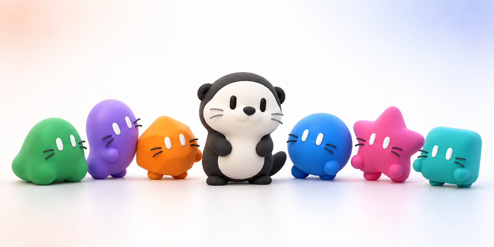

<h1 align="center">Otter Bot</h1>

  <b>대답하는 AI 말고, 일을 끝내는 Bot.</b> 
  AI Bots that finish the work, not just answer.

  <a href="https://github.com/Mineru98/otter-bot/releases">Download · 내려받기</a> ·
  <a href="https://otter-bot-harness.usefullabs.co.kr">Website · 소개 페이지</a>

---

## 스킬을 부르면 인자 가이드가 따라와요 · Skills come with an argument guide

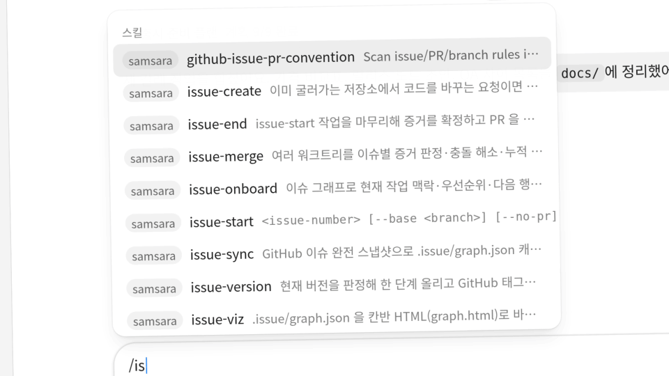

메시지 창에 `/`로 스킬을 부르면 받는 인자가 가이드 카드로 떠요. 가이드 안에서 바로 값을 넣고 옵션을 고릅니다. 다 채우면 명령이 완성됩니다.

Type `/` to call a skill and its arguments open as a guide card. Fill values and pick options right inside the guide, and the command writes itself.

---

## 1. 일 맡기기 · Hand off work

### 채팅으로 맡기기 · Ask in chat

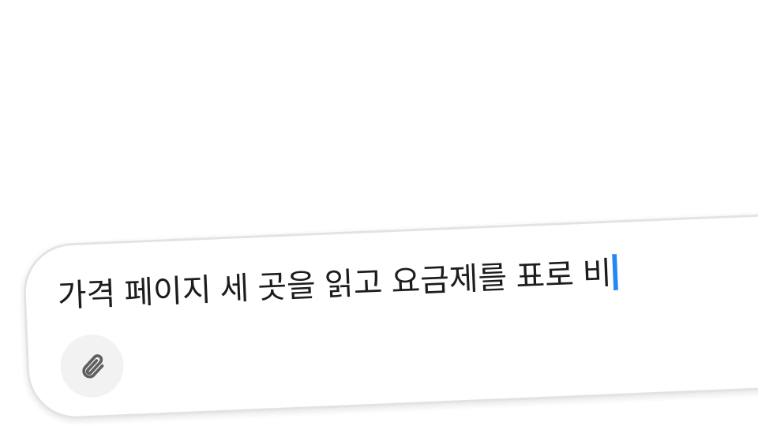

Bot에게 일을 맡기면 웹을 찾아 읽고, 표로 정리하고, 파일로 저장합니다. 진행 상황은 채팅 안에서 그대로 보입니다.

Hand a Bot a task and it searches the web, sums it up in a table and saves the file, with every step shown right in the chat.

### 모호하면 선택지로 물어요 · Choices when it's unclear

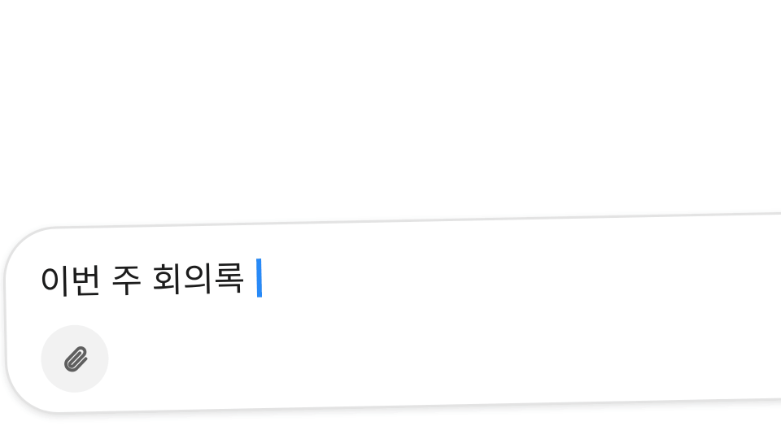

요청이 모호하면 Bot이 길게 묻지 않고 선택지 카드를 띄웁니다. 하나를 고르면 바로 이어서 작업합니다.

When a request is ambiguous, the Bot asks with a quick choice card instead of a long message. Pick one and it carries on.

### 모르는 말은 따로 묻기 · Ask aside

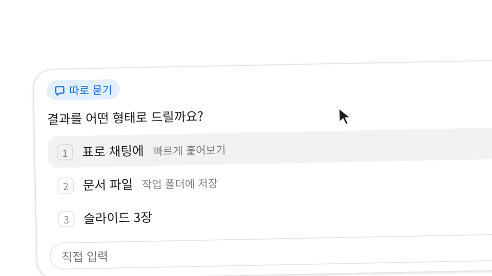

질문 카드에 모르는 말이 있으면 `따로 묻기`로 곁채팅을 열어 물어보세요. Bot이 뜻을 설명하고 추천 답을 골라 둡니다. 확인하고 보내기만 하면 됩니다. 곁채팅은 원래 대화에 남지 않습니다.

Not sure what an option means? Open "Ask aside" to ask in a side chat. The Bot explains, pre-selects the answer it recommends, and you just send it. The side chat stays out of the main conversation.

## 2. 지켜보고 멈추기 · Stay in control

### 채팅마다 권한 모드 · Permission mode per chat

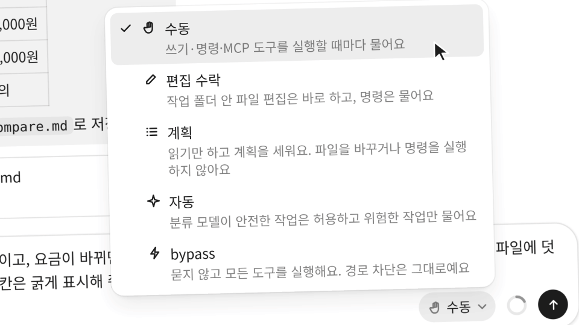

채팅마다 권한 모드를 고릅니다. 수동, 편집 수락, 계획, 자동, bypass 중 하나를 고르면 칩이 바뀝니다. bypass에서는 경고 배너와 붉은 테두리가 뜹니다. 배너에서 한 번에 수동으로 돌릴 수 있습니다.

Pick a permission mode per chat: Manual, Accept edits, Plan, Auto or Bypass. The chip changes with each one, and Bypass raises a warning banner and a red outline with a one-click way back to Manual.

### ESC 두 번이면 멈춰요 · Stop with ESC twice

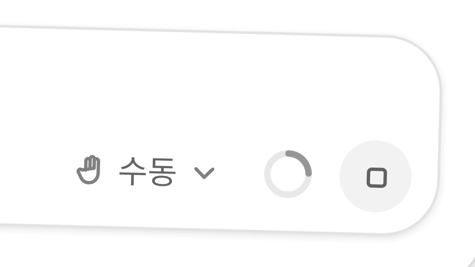

답하는 중에 ESC를 누르면 정지 버튼이 3초 카운트로 바뀝니다. 입력창 위에는 안내가 떠오릅니다. 한 번 더 누르면 바로 멈춥니다. 지금까지 쓴 답은 그대로 남습니다.

Press ESC while a Bot is answering and the stop button turns into a 3-second countdown with a hint above the box. Press it again to stop right away, keeping the reply so far.

## 3. 큰 일은 나눠서 · Big jobs, split up

### 작업 카드로 진행 보기 · Follow the plan

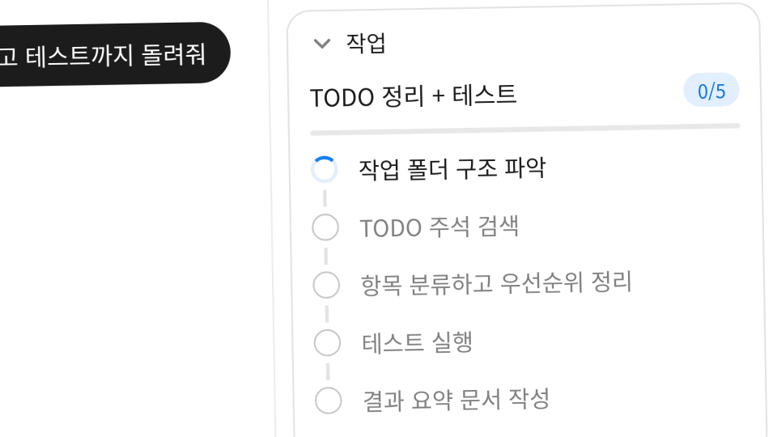

Bot이 계획을 세우면 세부 정보 패널의 작업 카드에 단계가 쌓입니다. 단계는 하나씩 진행 중에서 완료로 바뀝니다. 사이드바에 고정한 다른 Bot들의 작업 상태도 바로 보여요.

When a Bot plans, the Tasks card in the details pane lists each step and ticks it from running to done. Other Bots pinned in the sidebar show their status live.

### 갈래로 나눠 동시에 · Parallel lanes

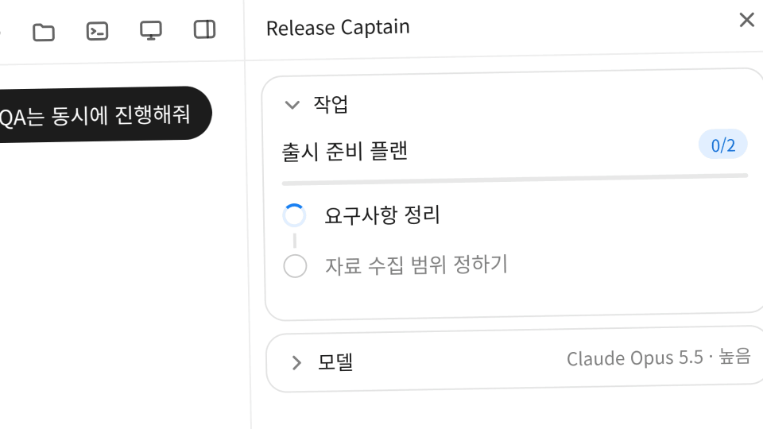

일이 커지면 Bot이 계획을 여러 갈래로 나눕니다. 서브 에이전트마다 자기 worktree에서 동시에 일합니다. 끝나면 결과를 한곳으로 합쳐요.

When the work grows, the Bot splits its plan into lanes. Each sub-agent works in its own worktree at the same time, and the results merge back into one.

  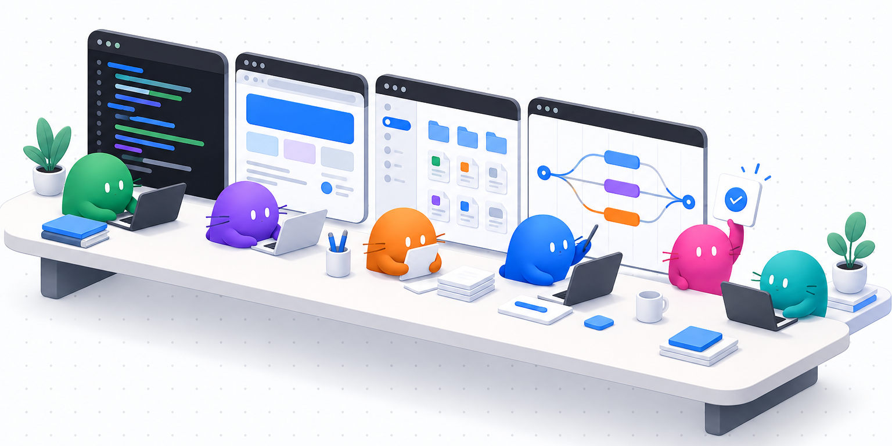

## 4. 여러 Bot과 함께 · Work with several Bots

### 그룹 채팅 · Group chat

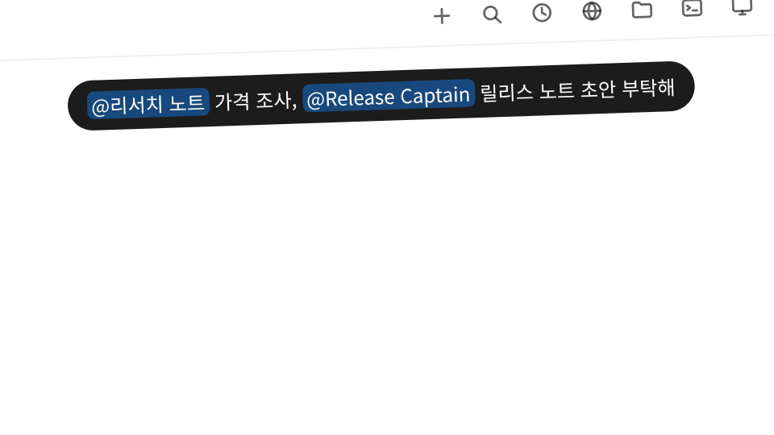

그룹 채팅에서 여러 Bot을 멘션하면 동시에 답합니다. Bot은 다른 Bot을 @멘션해 일을 넘깁니다.

Mention several Bots in a group chat and they answer at once, then hand work to each other with an @mention.

### @로 대화에 초대 · Invite with @

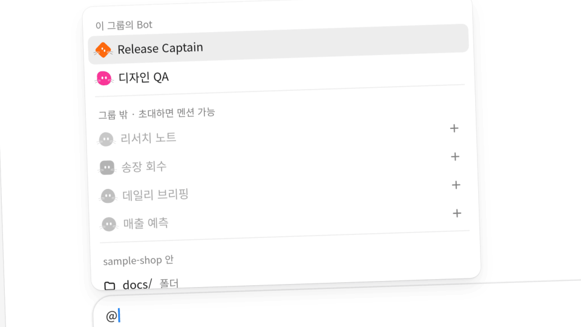

그룹 채팅에서 @를 치면 그룹 밖 Bot도 목록에 나옵니다. 고르면 그 자리에서 이 대화에 초대합니다. 초대한 Bot은 바로 멘션할 수 있습니다.

Type @ in a group chat and Bots outside the group show up too. Pick one to invite it into this chat on the spot and mention it right away.

## 5. 반복은 루틴으로 · Routines

### 말로 루틴 만들기 · A routine from one sentence

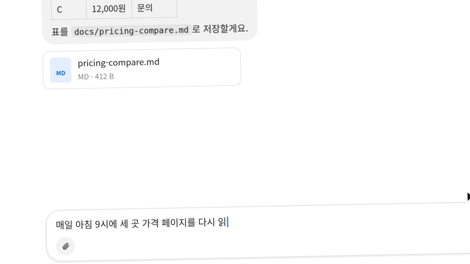

"매일 아침 9시에 …" 하고 말하면 Bot이 루틴을 만듭니다. 저장하기 전에 승인을 받습니다. 저장된 루틴은 예약 칸에서 바로 열어 고칠 수 있습니다.

Say "every morning at 9, …" and the Bot drafts a routine, asks for your approval and saves it. Open it in the Routines panel right away to adjust it.

## 6. 내 Bot으로 맞추기 · Make it yours

### 추론 강도와 fast 모드 · Reasoning effort and fast mode

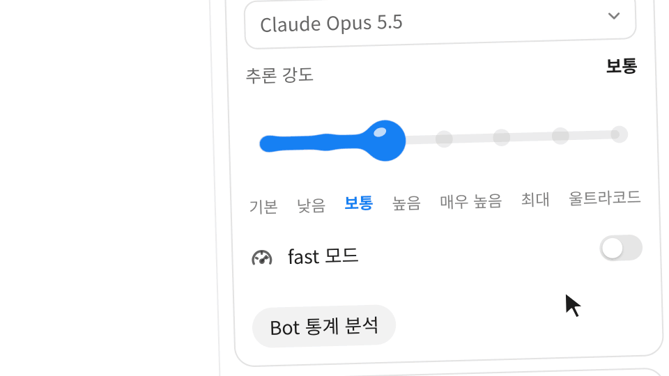

추론 강도를 올리면 슬라이더가 색을 바꾸며 반응합니다. 최대에서는 MAX 효과가 터집니다. fast 모드를 켜면 ⚡ FAST 표시가 붙습니다. 컨트롤 전체도 빨라집니다.

Raise the reasoning effort and the slider changes color as it climbs, bursting into a MAX effect at the top. Turn on fast mode and a ⚡ FAST mark appears while the whole control speeds up.

### Bot 꾸미기 · Style your Bot

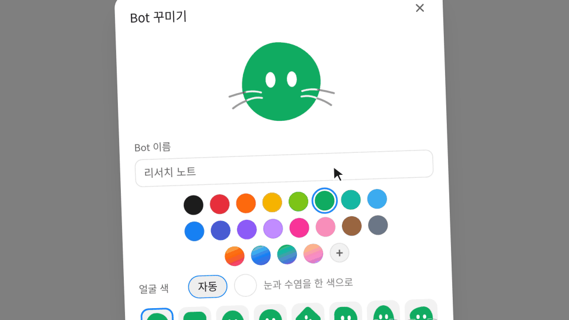

Bot의 모양, 색, 그라디언트, 얼굴 색을 고르는 대로 아바타가 바로 바뀝니다. 저장하면 채팅과 사이드바도 새 모습으로 바뀝니다.

Pick a shape, a color, your own gradient and a face color, and the Bot's avatar changes as you go. Save, and the chat and sidebar show the new look.

### Bot마다 맞춘 스킬 · Skills fitted to each Bot

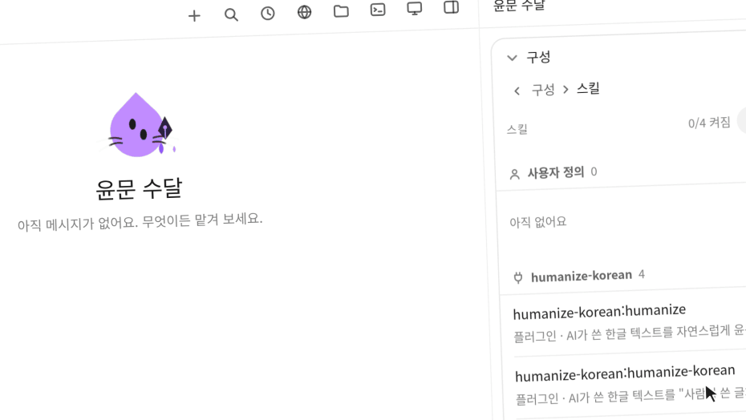

Bot마다 쓰는 스킬이 다릅니다. 글쓰기 Bot에는 윤문 스킬을 켭니다. 엔지니어 Bot에는 단계에 맞는 플러그인 스킬을 켭니다. 처음 설계할 때는 Superpowers, 코드가 자리 잡은 뒤에는 pstack을 쓰는 식입니다. 프로젝트가 자라면 Bot만 바꿔 쓰면 됩니다.

Each Bot carries its own skills. A writing Bot gets editing skills, and engineer Bots get plugin skills that fit the stage: Superpowers while you design, pstack once the codebase has settled. When the project grows, just switch Bots.

---

## Roadmap / 예정

> 이 섹션의 기능은 아직 없습니다. 만들 예정인 기능입니다. 
> Nothing in this section ships yet. These are planned features.

### (예정) 여러 장비를 하나의 작업 공간으로 · (Planned) Many machines, one workspace

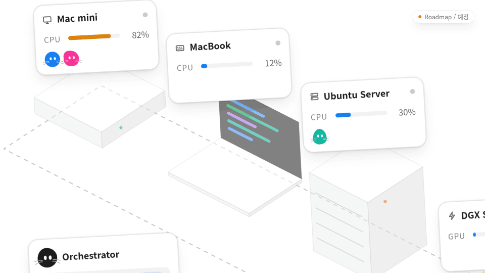

(예정) Mac mini, MacBook, Ubuntu Server, DGX Spark를 하나의 작업 공간으로 묶습니다. 작업 성격에 맞는 장비로 Bot을 보내 리소스를 고르게 씁니다.

(Planned) Pool your Mac mini, MacBook, Ubuntu Server and DGX Spark into one workspace, and let Bots go to the machine that fits each job so the load stays balanced.

### (예정) Bot 마켓플레이스 · (Planned) Bot marketplace

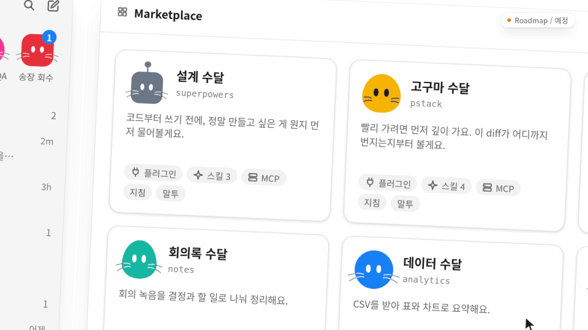

(예정) MCP·스킬·플러그인·지침·말투까지 맞춰 둔 Bot을 마켓에서 고릅니다. 사이드바로 끌어다 놓으면 바로 설치됩니다.

(Planned) Pick a Bot from the marketplace with its MCP servers, skills, plugins, instructions and tone already set up, then drag it into your sidebar to install it.

### 그 밖의 예정 · More planned

- **예정 · Planned** 더 많은 AI Provider 지원 · More AI providers
- **예정 · Planned** 더 빠른 자료 탐색을 위한 [AutoRAG](https://github.com/Marker-Inc-Korea/AutoRAG) Agent 도입 · An AutoRAG agent for faster search across your files
- **예정 · Planned** [omarchy](https://github.com/omacom/omarchy) VM Control 연결과 제어 최적화 · omarchy VM Control support and control tuning
- **예정 · Planned** Claude Code · Codex 플러그인 설정 마이그레이션 · Claude Code and Codex plugin settings migration
